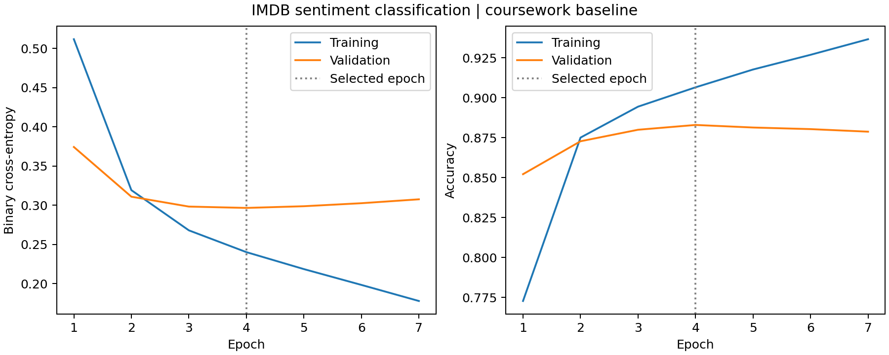

# IMDB sentiment classification with Keras

A **coursework project** adapted from my R/Keras exercise into a standalone Python workflow. It trains a feed-forward neural network to classify IMDB movie reviews as positive or negative, with configurable architecture and training hyperparameters.

The original exercise involved changing model/training parameters and inspecting results. This repository preserves the supplied configuration and makes those choices reproducible in Python. Only runs with saved outputs are reported as measured results.

## Model and data

| Setting | Baseline |
| --- | --- |
| Vocabulary | 2,000 token IDs |
| Representation | Binary multi-hot vector; word order discarded |
| Network | Dense 512 ReLU → Dense 16 ReLU → Dense 1 sigmoid |
| Trainable parameters | 1,032,737 |
| Optimizer | Adam, learning rate 0.0001 |
| Batch size / maximum epochs | 128 / 7 |
| Loss | Binary cross-entropy |
| Split | 20,000 training / 5,000 validation / 25,000 test reviews |

The validation set is drawn only from Keras's original training partition. The predefined test partition is never used in `fit()` or to choose the best epoch. The training/validation split indices, seed and configuration are saved for each run.

Early stopping monitors validation loss and restores the best weights. The original `patience=10` is retained: with seven maximum epochs it cannot stop training early, but it still selects/restores the best validation-loss weights at the end.

## Recorded baseline run



| Metric | Recorded value |
| --- | --- |
| Selected epoch (lowest validation loss) | 4 of 7 |
| Validation accuracy / loss | 88.30% / 0.2965 |
| Held-out test accuracy / loss | 87.13% / 0.3055 |

This is one Python baseline run, not a comprehensive hyperparameter search. The original R comparison results were not supplied, so no historical improvement is claimed. Training accuracy rose after epoch 4 while validation loss worsened, illustrating why validation-based selection matters.

[Metrics and environment](examples/baseline_metrics.json), [epoch log](examples/history.csv), and [sample prediction probabilities](examples/sample_predictions.json) are included. The recorded run used Python 3.11.8, TensorFlow 2.20.0 and NumPy 1.26.4. Test metrics are evaluated after restoring validation-selected weights, not necessarily the final epoch's weights.

## Run

Use Python 3.11 or 3.12 with a compatible TensorFlow installation:

```bash
python -m venv .venv
source .venv/bin/activate
python -m pip install -r requirements.txt
python train.py --output outputs/baseline
```

Keras downloads and caches the IMDB data on first use. By default the script reports **validation results only**, leaving test evaluation opt-in.

### Hyperparameter experiments

Architecture, learning rate, batch size, epochs, vocabulary size and early-stopping patience can be changed from the command line. For example:

```bash
python train.py --hidden-units 128 16 --learning-rate 0.001 \
  --batch-size 64 --epochs 15 --patience 3 --output outputs/experiment_01
```

Keep the split seed fixed when comparing configurations. Summarize completed runs using validation loss:

```bash
python compare_runs.py outputs/baseline/metrics.json \
  outputs/experiment_01/metrics.json
```

After finalizing a configuration, evaluate it on the held-out test set:

```bash
python train.py --output outputs/final --evaluate-test
```

Use the same selected CLI settings for that final run. Do not repeatedly select models based on test accuracy. The alternate configuration above is an example command, not a reported completed experiment.

## Outputs

Each run writes its own directory and refuses to overwrite a nonempty one:

- `model.keras`: saved model and optimizer state.
- `config.json`, `metrics.json`: settings, split sizes, selected epoch, evaluation and runtime versions.
- `history.csv`, `training_history.png`: training and validation learning curves.
- `split_indices.npz`: reproducible training/validation row assignments.
- `model_summary.txt`: architecture and parameter counts.
- `predictions.json`: first ten test predictions and decoded excerpts, only when test evaluation is enabled.

Large model/data files and generated run directories are excluded from Git. Small recorded baseline results are provided in `examples/`.

## Skills demonstrated

Neural-network architecture design; training from random initialization; optimizer and hyperparameter configuration; validation-based epoch selection; loss-curve inspection; held-out evaluation; model serialization; and translation of an R/reticulate workflow to Python.

**This is hyperparameter experimentation and training, not pretrained-model fine-tuning.** No pretrained weights, transformer or LLM are used. Word order is discarded by the multi-hot representation.

## Conversion and checks

The vectorizer preserves the original R convention: token ID `i` activates Python column `i-1`, while padding ID 0 is ignored. The NumPy random split is reproducible in Python but does not reproduce R's `set.seed()` sample byte-for-byte. TensorFlow is seeded, but identical results across machines/library versions are not guaranteed. The native `.keras` format replaces the original HDF5 model save.

Run the preprocessing checks without TensorFlow:

```bash
python -m unittest discover -s tests -v
```

Checks cover R/Python token indexing, padding/repeated words, complete and disjoint training/validation splits, and the IMDB decoding offset.

## Attribution

Python adaptation by Nihan Karagul, based on an R/Keras coursework exercise. The supplied R document was dated 29 January 2026; the Python adaptation and recorded run were created in October 2026. This is an educational project on a standard benchmark, not a claim of a novel architecture or a production sentiment system.

- [Keras IMDB dataset documentation](https://keras.io/api/datasets/imdb/)
- [Stanford Large Movie Review Dataset, Maas et al. (2011)](https://ai.stanford.edu/~amaas/data/sentiment/)
- [Keras training and evaluation guide](https://keras.io/guides/training_with_built_in_methods/)

Dataset rights and attribution requirements remain with their original sources. The repository license covers the Python adaptation.
